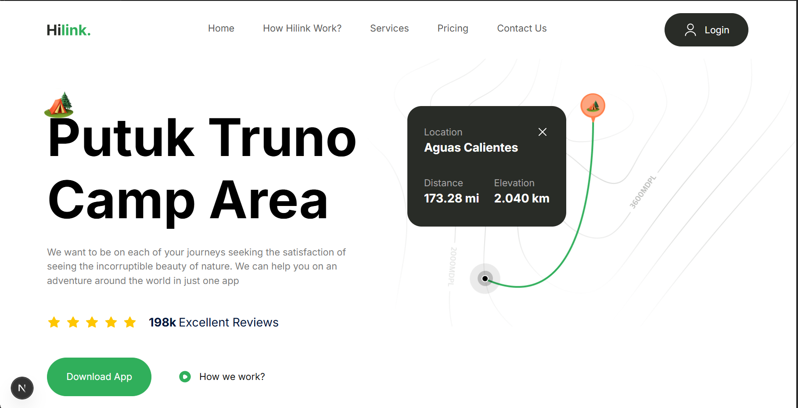

# Hilink

Hilink is a landing page for a travel and adventure app. It presents camp locations, app features, and download options in a clean layout that adapts to phones, tablets, laptops, and large desktop screens.

The project focuses on reusable components, a consistent design system, and clean, type-safe code.

## 🚀 Features

- Single-page layout with smooth, well-organized sections
- Fully responsive on mobile, tablet, desktop, and ultra-wide screens
- Reusable, typed React components (`Button`, `FooterColumn`, `FeatureItem`, and more)
- Custom design system with Tailwind CSS v4 (`@theme` tokens and `@utility` classes)
- Optimized images with `next/image`
- Client-side navigation with `next/link`
- Content kept in a single constants file for easy editing
- Statically prerendered for fast loading
- Deployed on Vercel

## 💻 Technologies used

- **Next.js**
- **TypeScript**
- **Tailwind CSS**

## 📸 Screenshots

### Homepage



## 🛠️ Getting started

### Prerequisites

- [Node.js](https://nodejs.org/) 18.18 or later
- npm (comes with Node.js)

### Installation

1. Clone the repository

   ```bash
   git clone https://github.com/Taha-bukhari/Hilink.git
   ```

2. Go into the project folder

   ```bash
   cd Hilink
   ```

3. Install the dependencies

   ```bash
   npm install
   ```

4. Start the development server

   ```bash
   npm run dev
   ```

5. Open [http://localhost:3000](http://localhost:3000) in your browser.


## 🌐 Live Demo

[https://your-project.vercel.app](https://hilink-henna.vercel.app/))

## 👨‍💻 Author

**Syed Taha Bukhari**

- GitHub: [@Taha-bukhari](https://github.com/Taha-bukhari)
- LinkedIn: [My LinkedIn Profile](https://linkedin.com/in/tahabukhari-a512702a8)
- Email: tahabukhari175@gmail.com
